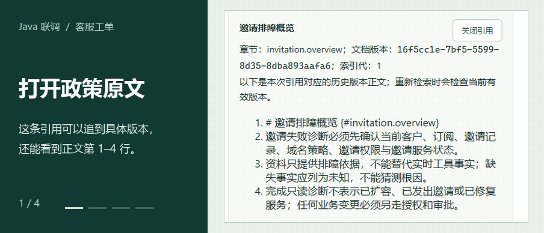

# SupportFlow

「同事收到了邀请，为什么还是加不进来？」我做了一个模拟 SaaS 客服工作台，让客服能查邀请、域名和剩余席位，点开回答里的引用就能读到政策原文。**唯一的业务写动作是授予临时席位**，需要另一位主管批准具体的席位数和有效期。

React / TypeScript · FastAPI · LangGraph · PostgreSQL + pgvector · Celery / Redis · Spring Boot（可选业务服务）　[跳到启动命令](#跑起来)

- **提交后丢响应**测了 3 轮。每轮只发出 1 次写请求，数据库留了 1 份回执，重复授予 0 次。
- **8 个请求同时加席**，直接请求 Java 接口，固定同一动作和参数，全程未调用模型。1 个返回 `201`，7 个返回 `200`，订阅版本只从 7 变到 8。
- **19 道检索题**，从纯向量换成混合检索，前五条至少命中一条依据的题数从 15 变成 18，找齐全部依据的题数却从 7 降到 6。



*前两帧来自真实 DeepSeek 与 Java 联调。后两帧来自独立的浏览器重连实验。*

## 跑起来

在 Windows x64 上准备 PowerShell、Git、能运行 pip 的 Python、Node 24.14.0 和 npm 11.9.0。启动 Docker Desktop，切到 Linux 容器。首次安装和下载嵌入模型需要联网，从仓库根目录执行下面三行。

```powershell
powershell.exe -NoProfile -ExecutionPolicy Bypass -File tools/setup-env.ps1 -Stage Install
New-Item -ItemType Directory -Force .local | Out-Null
.venv/Scripts/python.exe -I -B tools/prepare_embedding.py --output .local/embedding-setup.json
```

完整工单演示需要自己的 DeepSeek API 密钥，单行保存在本机 `deploy/supportflow/.secrets/deepseek_api_key`。下面两条启动命令选一条，两种模式都使用端口 18080。

**用默认 Python 沙箱跑工单**

```powershell
powershell.exe -NoProfile -ExecutionPolicy Bypass -File tools/serve-workspace.ps1 -Minutes 15 -WithWorker -WithKnowledge -WithProposal -WithApproval -WithExecution -WithDemoData
```

**让 Spring Boot 执行加席并保存回执**。需要能编译 Java 21 的 JDK，联调用的是 JDK 25。Java 使用独立的 PostgreSQL 业务卷。

```powershell
powershell.exe -NoProfile -ExecutionPolicy Bypass -File tools/serve-workspace.ps1 -Minutes 15 -WithWorker -WithKnowledge -WithProposal -WithApproval -WithExecution -WithDemoData -WithJavaSandbox
```

用两个独立浏览器会话打开工作台，分别登录客服 `a_support` 和主管 `a_supervisor`。启动脚本生成的密码在本机 `deploy/supportflow/.secrets/seed-accounts.json`。只想看登录和工单界面时，启动参数可缩成 `-Minutes 5`，无需模型密钥。到时服务自动停止，数据卷保留。[打开本机工作台](http://127.0.0.1:18080/tickets)

**试一张工单。** 为 C-001 建工单，问「member@example.com 加不进来，帮我查一下邀请、域名和席位」。点开一条引用看原文，再明确申请 10 个临时席位、有效期 3 天。若当前订阅符合政策，用主管账号审批，回到客服页查看回执。[提案规则](apps/supportflow/domain/grant_policy.py)

<details>
<summary>单独验证 Java 构建、部署配置和前端测试</summary>

```powershell
pwsh -NoProfile -File tools/build-spring-sandbox.ps1
.venv/Scripts/python.exe -I -B -X utf8 tools/verify-spring-workbench-deploy.py
```

```powershell
npm.cmd --prefix apps/supportflow/web ci --no-fund --no-audit
npm.cmd --prefix apps/supportflow/web run build:product
$ui = @(Get-ChildItem tests/supportflow -Filter 'ui_*.test.mjs' | Sort-Object Name | ForEach-Object FullName)
node --test @ui
```

</details>

## 席位加了，响应却丢了，怎么办？

我特意把故障放在提交之后。Java 在同一个 PostgreSQL 事务里更新订阅、写入回执。测试代理确认回执已经落库，才截断 HTTP 响应。Python 没收到结果，把执行标成待核对，用原来的 `action_id` 查回执，再读订阅核验。

第二轮连续两次查到 `404`，第三次才读到回执。**这里的 404 只说明当时还读不到回执。已经提交的加席也可能出现这个结果，所以不能据此重发写请求。** 三轮故障注入固定了模型回复，每轮使用新动作。[Python 对账逻辑](apps/supportflow/jobs/grant_reconciliation.py) · [Java 事务与回执](apps/supportflow/spring-sandbox/src/main/java/io/supportflow/sandbox/GrantStore.java)

8 个并发请求测的是另一个问题。如果同一条命令几乎同时到达，后到的请求会在拿到订阅锁后再查一次回执。实测八个响应指向同一份回执。另有一条保护在 Python 派发前起效。哪怕主管已经批准，等待期间客户若已扩容，旧订阅版本的那次申请也会停下来。[并发与审批后版本变化的验收记录](docs/verification.md)

## 检索找到一条依据，就够回答吗？

一张工单可能既要判断邀请是否有效，又要解释为什么不能扩容。前五条里找到邀请规则，仍可能漏掉容量政策。我因此把 Hit@5 和“找齐”分开记。向量检索加上 BM25 后，19 道题里有 3 道原本没有命中的题找到了依据，但找齐的题数反而由 7 道降到 6 道。还有一道题，两种策略都没命中。两次越权读取引用的检查也都被拒绝。[逐题检索结果](docs/verification/sf-ri.md#检索)

## 踩过的坑

- 第一次采集 Java 联调结果，容器连 `apps.supportflow.tools` 都导入不了。漏挂的是 Python 工具目录，采集器还没走到业务断言。
- 补好挂载，又碰到一句 `Cannot open a client instance more than once.`。采集代码对同一个 HTTP 客户端打开了两次，修的是客户端的生命周期。
- 另一次，浏览器已经拿到了诊断引用，下一步提交加席申请却超时了。后来让浏览器先在同一张工单上重读服务端的完成状态，再发申请。新一轮才走通从审批到回执的全程。[联调验收记录](docs/verification.md)

## 这些结果能说明什么？

原版 v9 在修复前冻结了 534 个正式单元，原始账本是 **404 个通过、102 个失败、28 个执行错误**。后来的复验单独记账。以末批 19 项为例，6 项重新运行，13 项沿用原运行记录补证据、重新审核，19 项最终均通过。开发提交 `8cb9a34d` 上通过的 **1,752 项**是 Python 离线测试，统计的是代码回归。[原版 v9 账本](docs/verification/v9-final.json) · [按版本查看复验与回归批次](docs/verification.md)

可靠性评测单看原 Python 沙箱的 13 个写入场景，每个场景核了 3 轮数据库。39 轮里重复变更为 0，其中 3 轮在提交后按预期取消。数据都是模拟 SaaS 工单，项目尚无独立盲测准确率。[可靠性记录](docs/verification/sf-ri.md#可靠性) · [打开本机评测页](http://127.0.0.1:18080/evaluation)
